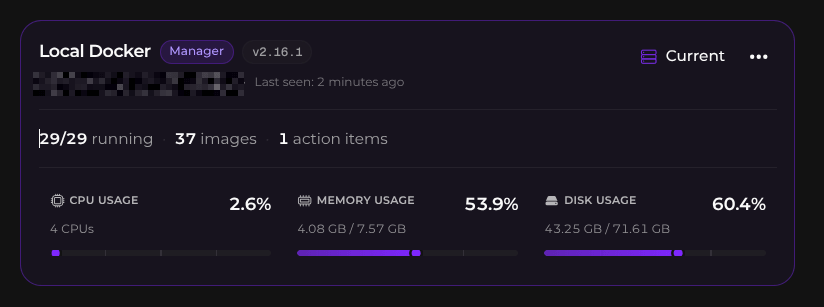
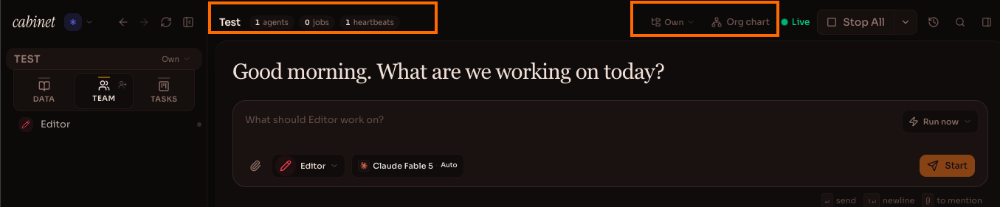

Every now and then I hang out on the [r/selfhosted](https://www.reddit.com/r/selfhosted/) subreddit looking for something else to self-host. People post screenshots of their dashboards, their home servers and all that.

Recently I decided to find a tool that tracks new versions of Docker containers. The well-known Watchtower [was archived](https://github.com/containrrr/watchtower/discussions/2135), so I needed something else. I [found a thread](https://www.reddit.com/r/selfhosted/comments/1x8ppmr/best_docker_management_tool/) on the topic and looked at the popular Komodo, but it takes 500 MB of memory — kind of heavy for my task. The same thread mentioned Arcane, which I had never heard of, and here we go...
The Arcane repo is very popular — 8k stars. I installed it on my server and shuddered. I had seen this font before... and to me it is a sign of AI slop software.

## How to spot slopware by its commit history

I went digging into the repo history and found some interesting stats, but let's run an experiment first.
Below is a table with the commit history of some open source projects. Take a look and think about which repos look weird and which look fine. Commits from bots like Renovate are excluded from the table.

| Project | First commit | Commits | Without merges | Authors ≈ | Commits/month | Stars |
|---|---|---|---|---|---|---|
| 1 | 06.2013 | 6123 | 5758 | 272 | ~38 | 38.2k |
| 2 | 04.2025 | 2950 | 2916 | 89 | ~163 | 7.9k |
| 3 | 03.2022 | 2859 | 2830 | 24 | ~53 | 12.3k |
| 4 | 10.2017 | 2065 | 1776 | 80 | ~19 | 15.1k |
| 5 | 03.2026 | 1308 | 1196 | 26 | ~270 | 2.9k |
| 6 | 10.2023 | 370 | 354 | 108 | ~12 | 24.1k |

To me, 2 repos stand out right away with a huge number of commits per month: 163 and 270. We know that Claude and other AIs love to churn out code, and these numbers illustrate that well.

The table with links to the repos on GitHub:

| Project | First commit | Commits | Without merges | Authors ≈ | Commits/month | Stars |
|---|---|---|---|---|---|---|
| [Cabinet](https://github.com/cabinetai/cabinet) | 03.2026 | 1308 | 1196 | 26 | ~270 | 2.9k |
| [Arcane](https://github.com/getarcaneapp/arcane) | 04.2025 | 2950 | 2916 | 89 | ~163 | 7.9k |
| [Komodo](https://github.com/moghtech/komodo) | 03.2022 | 2859 | 2830 | 24 | ~53 | 12.3k |
| [Portainer](https://github.com/portainer/portainer) | 06.2013 | 6123 | 5758 | 272 | ~38 | 38.2k |
| [CapRover](https://github.com/caprover/caprover) | 10.2017 | 2065 | 1776 | 80 | ~19 | 15.1k |
| [Dockge](https://github.com/louislam/dockge) | 10.2023 | 370 | 354 | 108 | ~12 | 24.1k |

The very popular Portainer has been around since 2013, and it makes 38 commits a month. Arcane, in 1.5 years, makes 163, which is almost 5.4 commits a day with no days off! To me it is pretty obvious that both Arcane and Cabinet are written entirely by Claude Code. I'm not putting that on my server. In the end I installed [What's Up Docker](https://github.com/getwud/wud) and connected it to Dynacat, and I have no regrets.

All services in the table except Cabinet are for managing Docker. Cabinet is an "AI-first" knowledge base. I added it for illustration. I saw it on someone's dashboard and thought I'd give it a try, but quickly removed this shit.

This tiny font you can't read... Broken buttons, a weird interface, constant errors... In short, AI slop.

Funny, but my own vibe-coded service doesn't disgust me like that. But when you install someone else's... ugh.

The number of stars surprises me too. Cabinet has 3k, Arcane has 8k. Do people not give a fuck? What are they looking at? The postmodern era...

Stay tuned.

